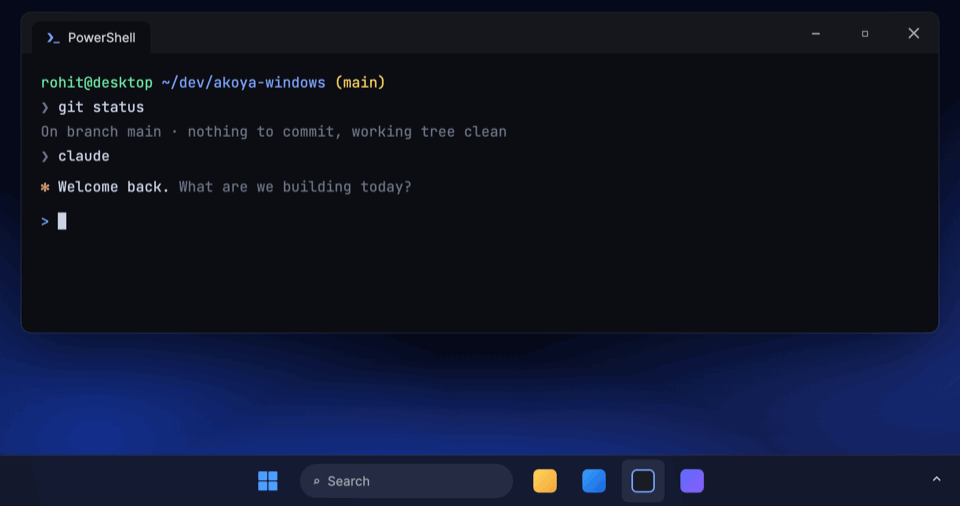

<div align="center">


# Akoya

**Hold a key, speak, release. Your words appear in any app.**

On-device dictation for the macOS menu bar.

[](https://github.com/rohitnikamm/akoya/releases/latest)   [](LICENSE)


</div>

## Features

- **Hold or tap.** Hold Right Option to talk, or tap once to start and again to stop. Esc cancels.
- **Private.** Transcription runs on your Mac with NVIDIA's Parakeet model. No audio leaves the device.
- **Works everywhere.** Text is pasted into whatever app has focus, and your clipboard is put back afterwards.
- **Lives in the menu bar.** A live waveform while you speak, and every setting in one dropdown: hotkey, microphone, icon style, launch at login.

## Install

```bash
brew install --cask rohitnikamm/tap/akoya
```

Open Akoya and follow the short setup: it asks for Microphone and Accessibility access and downloads the speech model (about 450 MB). Akoya is not notarized; the cask clears the quarantine flag so it opens without a Gatekeeper warning.

<div align="center">

</div>

## Usage

| Action | How |
| --- | --- |
| Dictate | Hold **Right ⌥**, speak, release |
| Hands-free | Tap **Right ⌥** to start, tap again to stop |
| Cancel | **Esc** while recording |
| Settings | Click the Akoya icon in the menu bar |

See the [guide](docs/GUIDE.md) for setup details, microphone handling and upgrading from Silk.

## Windows

A Windows 11 version is in the works. It's the same hold-to-talk dictation, but with a slim pill above the taskbar in place of the menu bar icon.

<div align="center">

</div>

### Install (once released)

When the first Windows release is published, download `Akoya-win-Setup.exe` from the [releases page](https://github.com/rohitnikamm/akoya/releases) (the one named "Akoya for Windows") and run it. It installs just for you, with no admin prompt, adds a Start menu entry and an uninstaller, and needs no .NET install.

Akoya is not code-signed, so Windows SmartScreen shows "Windows protected your PC" the first time: click **More info → Run anyway**. First-run setup lets you pick your microphone and downloads the speech model (about 480 MB). After that, Akoya updates itself from new releases: the tray panel shows "Update ready · Restart". Details for contributors are in [windows/README.md](windows/README.md).

## Build from source

Requires macOS 14+ on Apple Silicon and Swift 6 (the Command Line Tools are enough).

```bash
git clone https://github.com/rohitnikamm/akoya && cd akoya
swift test
scripts/build-app.sh debug   # builds build/products.noindex/Akoya.app
```

## Acknowledgements

Inspired by [Voxtype](https://github.com/peteonrails/voxtype) in [Omarchy](https://omarchy.org). Speech recognition by [FluidAudio](https://github.com/FluidInference/FluidAudio) running [Parakeet TDT](https://huggingface.co/nvidia/parakeet-tdt-0.6b-v2).

## License

[MIT](LICENSE)
