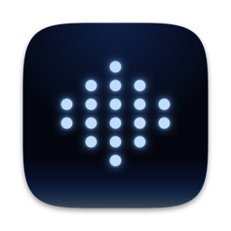
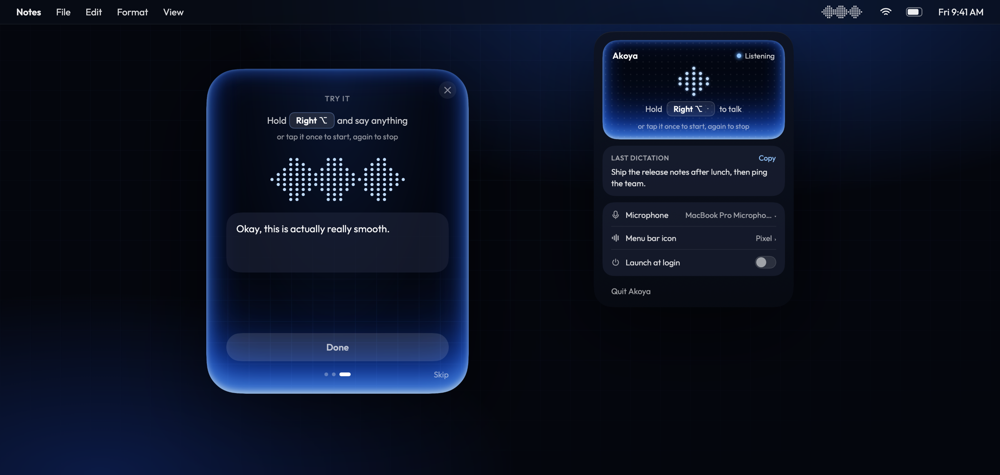
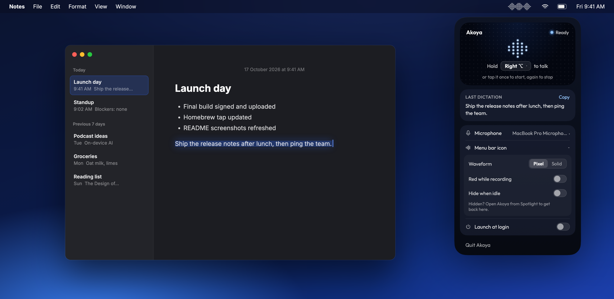
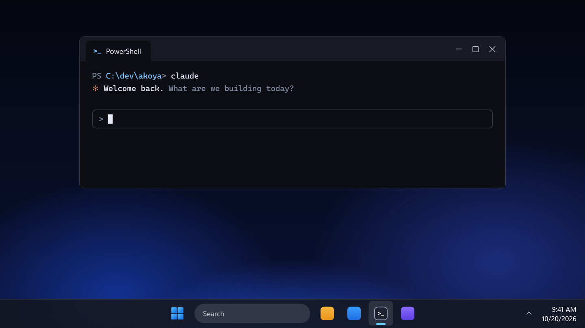
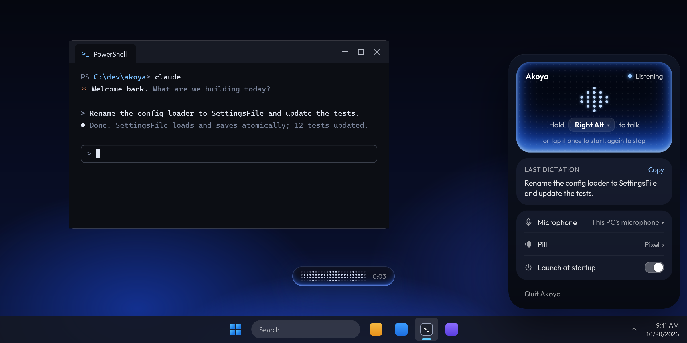

<div align="center">



# Akoya

**Hold a key, speak, release. Your words appear in any app.**

On-device dictation for macOS and Windows.

[](https://github.com/rohitnikamm/akoya/releases/latest)    [](LICENSE)



</div>

## Features

- **Hold or tap.** Hold Right Option to talk, or tap once to start and again to stop. Esc cancels.
- **Private.** Transcription runs on your Mac with NVIDIA's Parakeet model. No audio leaves the device.
- **Works everywhere.** Text is pasted into whatever app has focus, and your clipboard is put back afterwards.
- **Lives in the menu bar.** It shows a floating pill with a live waveform while you speak, and every setting in one dropdown: hotkey, microphone, indicator style, launch at login.

## Install

```bash
brew install --cask rohitnikamm/tap/akoya
```

Open Akoya and follow the short setup: it asks for Microphone and Accessibility access. The speech model is built into the app, so it works offline on first launch. Akoya is not notarized; the cask clears the quarantine flag so it opens without a Gatekeeper warning.

<div align="center">

</div>

## Usage

| Action | How |
| --- | --- |
| Dictate | Hold **Right ⌥**, speak, release |
| Hands-free | Tap **Right ⌥** to start, tap again to stop |
| Cancel | **Esc** while recording |
| Settings | Click the Akoya icon in the menu bar |

See the [guide](docs/GUIDE.md) for setup details, microphone handling and upgrading from Silk.

## Windows

The same dictation on Windows 11, with a slim pill above the taskbar in place of the menu bar icon.

<div align="center">

</div>

- **Hold or tap.** Hold Right Alt to talk, or tap once to start and again to stop. Esc cancels.
- **Private.** Transcription runs on your PC with the same Parakeet model. No audio leaves the device.
- **Works everywhere.** Text is pasted into whatever app has focus and stays on your clipboard, so Ctrl+V pastes it again anywhere.
- **Lives in the tray.** A pill while you speak, and every setting in one panel: hotkey, microphone, pill style, launch at startup.

### Install

Download `Akoya-win-Setup.exe` from the [releases page](https://github.com/rohitnikamm/akoya/releases) and run it. Setup picks your microphone; the speech model is built into the app, so it works offline on first launch, and after that Akoya keeps itself up to date. Akoya is not code-signed, so the first time Windows SmartScreen appears, click **More info → Run anyway**.

<div align="center">

</div>

### Usage

| Action | How |
| --- | --- |
| Dictate | Hold **Right Alt**, speak, release |
| Hands-free | Tap **Right Alt** to start, tap again to stop |
| Cancel | **Esc** while recording |
| Settings | Click the Akoya icon in the tray |

To build it yourself, see [windows/README.md](windows/README.md).

## Build from source

Requires macOS 14+ on Apple Silicon and Swift 6 (the Command Line Tools are enough).

```bash
git clone https://github.com/rohitnikamm/akoya && cd akoya
swift test
scripts/build-app.sh debug   # builds build/products.noindex/Akoya.app
```

## Acknowledgements

Inspired by [Voxtype](https://github.com/peteonrails/voxtype) in [Omarchy](https://omarchy.org). Speech recognition by [FluidAudio](https://github.com/FluidInference/FluidAudio) running [Parakeet TDT](https://huggingface.co/nvidia/parakeet-tdt-0.6b-v2).

Speech model: NVIDIA Parakeet TDT 0.6B v2, licensed CC-BY-4.0 (https://huggingface.co/nvidia/parakeet-tdt-0.6b-v2); Core ML conversion by FluidInference, ONNX int8 conversion by sherpa-onnx. License: https://creativecommons.org/licenses/by/4.0/

## License

[MIT](LICENSE)
